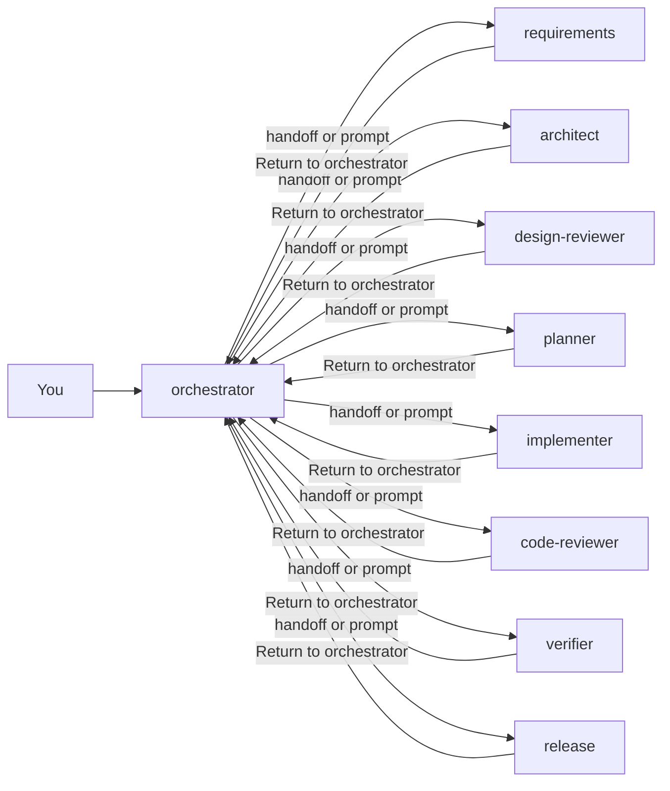

# Agentic SDLC — Lane Street Library hold shelf

GitHub Copilot workspace for a library hold shelf. Open this folder in Visual Studio. Custom agents, prompt files, instructions, and a skill run the lifecycle. The sample application in `src/holdshelf` is the desk tool already in use. The story in `docs/user-story.md` adds the long-waiting holds view on top of it, after each SDLC step is approved.

## How a step runs



`orchestrator` reads the repository and names the active step. It has no edit tool, so it cannot write the step files. You continue with that step's handoff button or its `/` prompt. The step agent reads the files on disk, does one step, and returns a status. The next step starts after you approve.

Visual Studio does not spawn subagents. Selecting the handoff, or running the prompt, is how the step agent gets the chat. In Copilot CLI and VS Code, `orchestrator` can also call the step agent with the `agent` tool.

| Step | Custom agent | Prompt | Outcome |
| --- | --- | --- | --- |
| Status | `orchestrator` | `/sdlc-status` | Which step is next |
| 1. Requirements | `requirements` | `/requirements` | `requirements.md` |
| 2. Architecture | `architect` | `/architecture` | `architecture.md` |
| 3. Design review | `design-reviewer` | `/design-review` | `design-review.md` |
| 4. Implementation plan | `planner` | `/implementation-plan` | `impl-plan.md` |
| 5. Implementation | `implementer` | `/implementation T1` | Code under `src/` and `tests/` |
| 6. Review | `code-reviewer` | `/code-review` | `code-review.md` |
| 7. Verify | `verifier` | `/verify` | `verification-report.md` |
| 8. Pull request | `release` | `/pull-request` | Changelog and pull request |

The incoming story is [docs/user-story.md](docs/user-story.md).

## Copilot files

| Copilot feature | Path | What it does here |
| --- | --- | --- |
| Custom instructions | [.github/copilot-instructions.md](.github/copilot-instructions.md) | Step order and approval gates for every chat |
| Path-specific instructions | [.github/instructions](.github/instructions) | Secrets, implementation rules, and artifact shape |
| Custom agents | [.github/agents](.github/agents) | `orchestrator` plus one agent per step, with tools and handoffs |
| Prompt files | [.github/prompts](.github/prompts) | Slash commands that select the agent for that step |
| Agent skill | [.github/skills/agentic-sdlc](.github/skills/agentic-sdlc) | Procedure and the guide for each step |
| Hooks | [.github/hooks/sdlc.json](.github/hooks/sdlc.json) | Session status and secret guards in Copilot CLI and Copilot cloud agent |

## Open in Visual Studio

1. In this folder, run `git init` if it is not already a repository, then commit when you want Step 1 to have a history. Add a GitHub remote before Step 8 if you want a real pull request.
2. In Visual Studio, use **File > Open > Folder** and pick this folder.
3. Sign in to GitHub Copilot. In **Tools > Options**, search for Copilot and turn on custom instructions, prompt files, and custom agents if any of them are off.
4. Open **Copilot Chat**, switch to **Agent** mode, and select **orchestrator**.
5. Run `/sdlc-status`, then `/requirements`.

### Demo

1. `/requirements`. The `requirements` agent asks the numbered questions. Reply with the answers. It writes `requirements.md`. Use **Return to orchestrator** and approve.
2. `/architecture`, review the assumptions, approve.
3. `/design-review`, decide each finding, then run it again with those decisions so `architecture.md` is updated.
4. `/implementation-plan`, approve the plan, and name the first free task.
5. `/implementation T1`, then repeat for each task you approve.
6. `/code-review`, `/verify`, then `/pull-request` when you want the pull request.

## Hooks

Hook files in `.github/hooks/` run in Copilot CLI and in Copilot cloud agent. Visual Studio does not run them. The same rules are in the instruction files, so they still apply in Visual Studio chat.

| Hook | Behavior |
| --- | --- |
| `sessionStart` | Reports which SDLC artifacts exist and which gate is next |
| `preToolUse` | Denies commands that print `.env` or the environment, and file tools aimed at secrets. Asks before force-push, `git reset --hard`, and forced `git clean`. |

The scripts use the Python standard library and the Copilot hook result fields `additionalContext` and `permissionDecision`.

## Layout

```text
.github/copilot-instructions.md   Repository instructions
.github/instructions/             Path-specific instructions
.github/agents/                   orchestrator and one agent per step
.github/prompts/                  One prompt file per step
.github/skills/agentic-sdlc/      Skill and step guides
.github/hooks/                    Hook config and scripts
.github/PULL_REQUEST_TEMPLATE.md  Required pull request sections
.github/workflows/ci.yml          Test workflow
docs/user-story.md                Incoming story: long-waiting holds
config/jira.example.json          Story source template (Jira, Confluence, Word, or file)
scripts/load_user_story.py        Loads that source into docs/user-story.md
src/holdshelf/                    Sample app: list holds and mark them picked up
tests/                            Hook tests and hold-shelf tests
```

Run the sample app, then open http://127.0.0.1:8765 :

```bash
PYTHONPATH=src python -m holdshelf
```

On PowerShell: `$env:PYTHONPATH = "src"; python -m holdshelf`

The overdue API and the "waiting too long" view are not in the app yet. Step 5 adds them after the story is approved. CI runs `python -m unittest discover -s tests -v`.

`requirements.md`, `architecture.md`, `design-review.md`, `impl-plan.md`, `code-review.md`, and `verification-report.md` are created at the repository root during the exercise.

## Checks

```bash
python -m unittest discover -s tests -v
```

## Prerequisites

- Visual Studio 2022 17.14 or later, or Visual Studio 2026, with GitHub Copilot
- Git, and the GitHub CLI (`gh`) if Step 8 should open the pull request from the terminal
- Python 3.9 or newer, available as `python` on Windows and `python3` on the Copilot cloud agent

## Working agreement

- One step at a time. Requirements are not written until you answer the clarifying questions.
- A missing patron phone on the long-waiting view is recorded as `Not Found`.
- Secrets stay out of chat, logs, commits, and generated docs.
- Commits and pull requests happen when you ask for them.
