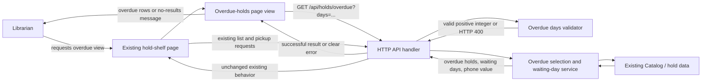

# Architecture — Overdue Hold Shelf

## Scope

This architecture supports HOLD-21 and the approved `requirements.md` only. It
adds an overdue-holds capability to the existing hold shelf without replacing
the existing hold list or changing the pickup action.

## Component diagram

## Components and responsibilities

### Existing hold-shelf page

- Remains the page at `/`.
- Keeps the existing hold list and pickup action.
- Provides an understandable action and result for the overdue-holds view.
- Provides an `Overdue Holds` action and a positive-integer `days` input.
  The input defaults to 7; a blank input uses 7, and invalid input is shown
  before any request is made.
- Displays each returned overdue hold's waiting-day count and phone.
- Displays the literal `Not Found` when the API returns that value for a
  missing phone.
- Communicates a successful no-results response and a clear invalid-window
  error.
- Must not display a guessed overdue list when the API request fails.
- Requests the overdue endpoint when the `Overdue Holds` action is invoked.
- On overdue-load failure, clears the overdue rows, shows a distinct error,
  and provides a Retry action; it never shows stale overdue rows.

### HTTP API handler

- Preserves `GET /api/health`, `GET /api/holds`, and the existing pickup route.
- Adds `GET /api/holds/overdue`.
- Reads the optional `days` query parameter.
- Uses the default window of 7 when `days` is absent.
- Returns HTTP 400 for every supplied value that is not a positive integer,
  with `{"error":"days must be a positive integer"}`.
- Returns the overdue result, including waiting days and the phone value.
- Returns a successful empty result when no hold qualifies.
- Returns successful results as
  `{"holds":[{"id":...,"title":...,"patron":...,"readySince":...,
  "status":...,"phone":...,"waitingDays":...}]}`.
- Returns `{"holds":[]}` for a successful empty result. The existing
  `GET /api/holds` response and missing-phone representation remain unchanged.

### Overdue days validator

- Distinguishes an absent `days` parameter from a supplied parameter.
- Converts only positive integer values into the configured pickup window.
- Rejects zero, negative, decimal, non-numeric, malformed, and valueless
  supplied parameters.
- Never silently falls back to another window for an invalid supplied value.

### Overdue selection and waiting-day service

- Selects only holds whose status is `ready`, whose `readySince` is present,
  and whose wait is longer than the configured pickup window.
- Excludes picked-up holds and holds without `readySince`.
- Calculates waiting days from `readySince` to today using the server's local
  timezone.
- Accepts `readySince` as a `YYYY-MM-DD` server-local calendar date and
  calculates the calendar-day difference.
- Includes a hold only when `waitingDays > days`.
- Excludes a hold with malformed `readySince` and logs only a non-sensitive
  diagnostic for that condition.
- Adds the waiting-days value to each overdue result.
- Converts a missing patron phone to the literal string `Not Found` for the
  overdue API and page.
- Does not alter the representation used by `GET /api/holds`.

### Existing catalog and hold data

- Remains the source of the existing holds and statuses.
- Continues to support the existing list and pickup behavior.
- Supplies the overdue service with hold identity, title, patron, status,
  `readySince`, and phone data.
- Does not require a replacement persistence system.

Persistence, deployment, authentication, and bootstrap behavior are **Not
Found**.

## Technology choice

Use the existing Python standard-library HTTP application and its current
in-process catalog, with the overdue behavior implemented as an additive API
and page capability.

This fits the requirements because:

- The application already exposes the required HTTP routes and serves the
  existing page.
- The standard library introduces no new dependency or deployment
  requirement.
- The current catalog already represents the data needed for filtering and
  preserves pickup compatibility.
- A small validation and selection boundary can enforce deterministic
  `days` handling and the server-local-timezone rule.
- The existing page can request and render the new endpoint while leaving
  `GET /api/holds` unchanged.

The exact production deployment technology and persistence technology are
**Not Found**.

## Data flow

1. The librarian invokes the overdue-holds action on the existing page and,
   where applicable, supplies a pickup-window value.
2. The page requests `GET /api/holds/overdue`, optionally with `days`.
3. The HTTP API handler passes a supplied `days` value to the validator.
4. The validator uses 7 for an absent parameter, accepts a positive integer,
   or returns HTTP 400 for an invalid supplied value. No hold list is guessed
   for an invalid request.
5. For a valid window, the overdue service reads the current holds from the
   existing catalog.
6. The service excludes picked-up holds, holds without `readySince`, and ready
   holds that have not waited longer than the configured window.
7. For each included hold, the service calculates calendar waiting days from
   `readySince` to today using the server's local timezone and maps a missing
   phone to `Not Found`.
8. The API handler returns the successful overdue response using the
   `{"holds":[...]}` envelope, or `{"holds":[]}` when empty. Invalid windows
   return the agreed 400 error object.
9. The page renders the returned overdue rows, including waiting days and
   phone, or communicates that no ready hold is past the window. A failed
   request clears rows, shows a distinct error, and offers Retry.
10. Existing list and pickup requests continue through their existing routes
    and behavior without using or changing the overdue response contract.

## Secrets, patron data, and logging

- No secrets are required by the approved requirements. Secret storage,
  configuration, and rotation are **Not Found**.
- Patron phone numbers are response data for the overdue view, not log data.
- HTTP request, validation, selection, and UI error logging must not include
  patron phone numbers, full overdue payloads, or secrets.
- Error messages should identify an invalid window without echoing sensitive
  hold or patron data.
- The page renders phone values only in the overdue view and uses `Not Found`
  for missing values.
- The exact logging, redaction, retention, and observability mechanisms are
  **Not Found**.

## Assumptions

- The existing page, routes, catalog, and hold data remain the source of
  existing behavior.
- The server's local timezone is available to both API calculation and page
  behavior through the server-produced response.
- A hold is overdue only when its waiting period is strictly longer than the
  configured pickup window.
- `readySince` is a `YYYY-MM-DD` server-local calendar date for overdue
  calculation. Malformed values are excluded and produce only a
  non-sensitive diagnostic log.
- The API and page use one shared overdue-selection behavior so they return
  the same set of holds.
- The overdue response uses the `holds` envelope and the agreed hold
  properties, including `waitingDays`; an empty result is `{"holds":[]}`.
- The page uses an `Overdue Holds` action and positive-integer `days` input
  with the agreed default, pre-request validation, and retry/failure behavior.
- Deployment, persistence, authentication, and observability requirements are
  **Not Found**.
